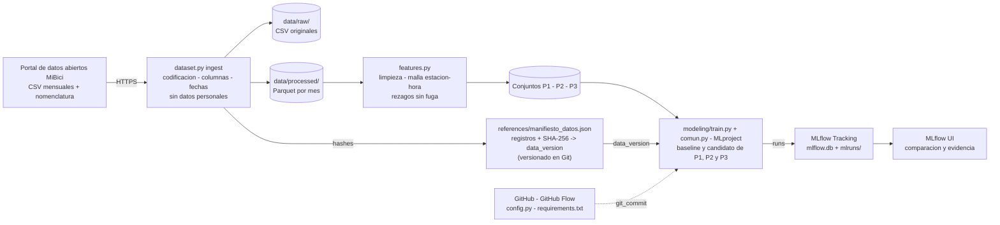

# Arquitectura del sistema - Proyecto MiBici (equipo 18)

Fuente editable del diagrama: [`arquitectura.html`](arquitectura.html) (abrelo en el navegador).
La misma arquitectura en Mermaid, que GitHub dibuja directamente:

## Componentes, herramientas y justificacion

| Componente | Herramienta | Que hace | Por que esta herramienta |
|---|---|---|---|
| **Fuente** | Portal de datos abiertos de MiBici (HTTPS) | Publica un CSV de viajes por mes y la nomenclatura de estaciones | Es la fuente oficial y la misma para todos los equipos; las URL exactas viven en `config.py` |
| **Ingesta** | `dataset.py` (requests, pandas, typer) | Descarga sin pasos manuales, detecta codificacion y formato de fecha por archivo, normaliza columnas, descarta datos personales | Un solo comando reproduce los datos en cualquier computadora; los formatos cambian entre anios y el script los maneja de forma explicita y probada |
| **Almacenamiento** | Sistema de archivos local: `data/raw` (CSV) y `data/processed` (Parquet con zstd) | Guarda los crudos tal como se publicaron y una copia limpia, columnar y comprimida | Parquet conserva tipos (fechas, enteros) y se lee por columnas, lo que importa con millones de viajes; no se necesita un servidor para 24 meses |
| **Versionado de datos** | Manifiesto JSON en Git + `hashlib` (SHA-256) | Registra filas y hash de cada archivo crudo y de su contenido limpio; `verify` comprueba que los datos locales coinciden | Ligero y suficiente: los datos no entran a Git pero su huella si, y la `data_version` se registra en cada run. DVC con almacenamiento remoto queda como evolucion si el volumen crece |
| **Procesamiento** | `features.py` (pandas, numpy) | Limpieza, malla estacion-hora con ceros, calendario y festivos, rezagos y medias sin informacion del futuro | Funciones reutilizables con docstring, probadas con pytest; en una prueba de escala con datos sinteticos del tamanio real tardo ~30 s |
| **Entrenamiento** | `modeling/` (scikit-learn): `comun.py` + un modulo por pregunta (`p1_regresion.py`, `p2_clasificacion.py`, `p3_clustering.py`), orquestados por `train.py` | Baseline y candidato para P1, P2 y P3 con el mismo registro en MLflow | Refactorizacion: lo comun (abrir el run, etiquetas, parametros, metricas con prefijo, figuras y modelo) vive una sola vez en `comun.py`; cada pregunta cumple el mismo contrato (`entrenar(roles)`) y solo define sus datos, su modelo y sus metricas |
| **Registro de experimentos** | MLflow Tracking (backend SQLite `mlflow.db`, artefactos en `mlruns/`) | Parametros, metricas por conjunto, etiquetas de equipo/pregunta/commit, artefactos y modelo con firma | Estandar del curso; la version de datos y el commit hacen cada run trazable y repetible |
| **Empaquetado reproducible** | MLflow Projects (`MLproject` + `python_env.yaml`) | `mlflow run . -P pregunta=P1 -P tipo_modelo=candidato` ejecuta un run con un solo comando | Define en un archivo el punto de entrada, sus parametros y el ambiente |
| **Consulta** | MLflow UI | Lista, detalle y comparacion de runs; artefactos (graficas, mapas, tablas) | Evidencia para el reporte y base para elegir modelos |
| **Codigo y colaboracion** | Git + GitHub (GitHub Flow), Cookiecutter Data Science | `main` protegida, cambios por Pull Request revisado, estructura estandar de carpetas | Cada cambio queda revisado y trazable; la estructura hace obvio donde va cada cosa |
| **Entorno** | Python 3.14 + `requirements.txt` con versiones fijas | Mismo entorno desde un clon limpio | Reproducibilidad del codigo ademas de los datos |

## Relacion con las lecturas de la semana

- **Huyen (2022), cap. 6:** el desarrollo de modelos empieza con baselines sencillos y
  sigue con candidatos mas complejos solo si los superan; ademas, el seguimiento de
  experimentos y el versionado de codigo y datos son lo que permite reproducir un
  resultado. Por eso cada pregunta tiene baseline y candidato, y cada run guarda
  `data_version`, semilla, hiperparametros y `git_commit`.
- **Wilson (2022), cap. 6:** experimentar con disciplina implica comparar alternativas con
  el mismo protocolo de evaluacion antes de comprometerse con una. Aqui todas las
  alternativas usan la misma particion cronologica, las mismas metricas con prefijo
  (`validacion_`, `prueba_`) y el mismo codigo de registro (`comun.py`).
- **Lauchande (2021), cap. 5:** MLflow no solo registra metricas, tambien administra
  modelos (formato estandar con firma y ejemplo de entrada). Los candidatos se registran
  con `mlflow.sklearn.log_model`, listos para pasar al Model Registry en entregas
  siguientes.
- **Thompson (2023), sec. 7.4 (*Making models with ML*):** la seccion trata el proceso de
  modelado (7.4.1) y el seguimiento de experimentos con repositorios de modelos (7.4.2), es
  decir, el trabajo de modelado como un proceso administrado y registrado, no como
  exploracion suelta. En este proyecto ese papel lo cumplen MLflow Tracking (cada intento
  es un run con datos, codigo y parametros) y el registro del modelo de cada candidato
  (`mlflow.sklearn.log_model`), que en entregas siguientes pasara al Model Registry.
- **Recursos de OOP y refactorizacion:** el codigo exploratorio se convirtio en modulos
  (`dataset.py`, `features.py`, `modeling/`) con funciones pequenas, documentadas y probadas;
  `comun.py` concentra lo que antes se repetiria en cada pregunta (un contrato comun en lugar
  de copiar codigo), y la ejecucion se empaqueta con MLflow Projects.

## Decisiones de diseno y alternativas descartadas

| Decision | Alternativa | Por que no (por ahora) |
|---|---|---|
| Manifiesto en Git para versionar datos | DVC con remoto (S3, Google Drive) | Requiere almacenamiento compartido y credenciales; para 24 meses publicos basta con la huella y la descarga reproducible |
| MLflow local con SQLite | Servidor compartido (DagsHub, Databricks) | Cada integrante puede reproducir sin cuentas; para entregas siguientes se puede apuntar `MLFLOW_TRACKING_URI` a un servidor en `.env` |
| pandas en una sola maquina | Spark o Dask | Los 9.04 millones de viajes caben en memoria agregando por estacion-hora (en una prueba de escala con datos sinteticos del tamanio real, el pico fue menor a 4 GB) |
| scikit-learn (HistGradientBoosting) | LightGBM o XGBoost | Mismo tipo de modelo sin dependencias extra; se puede evaluar en la siguiente iteracion |
