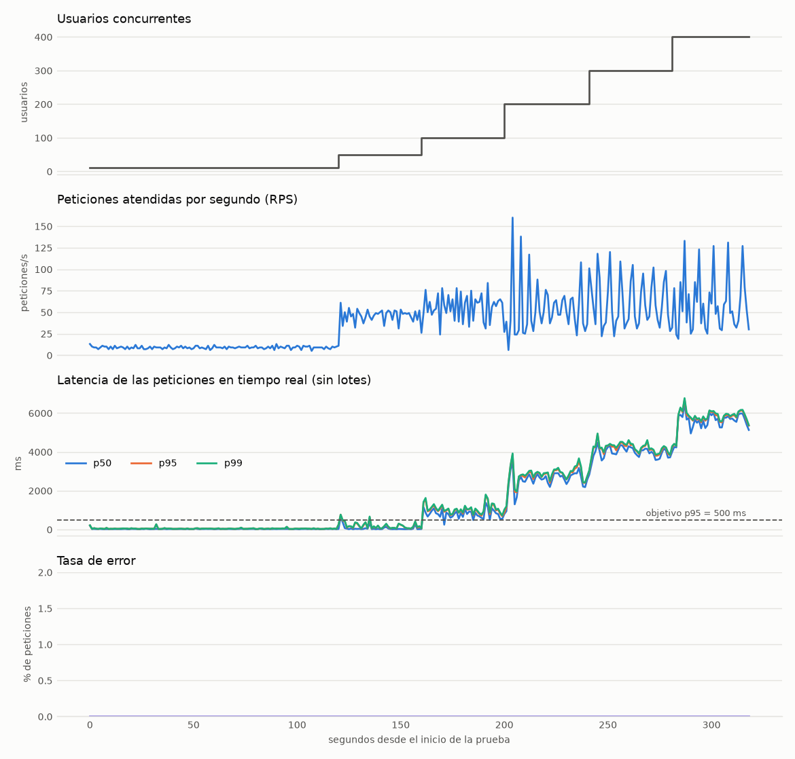
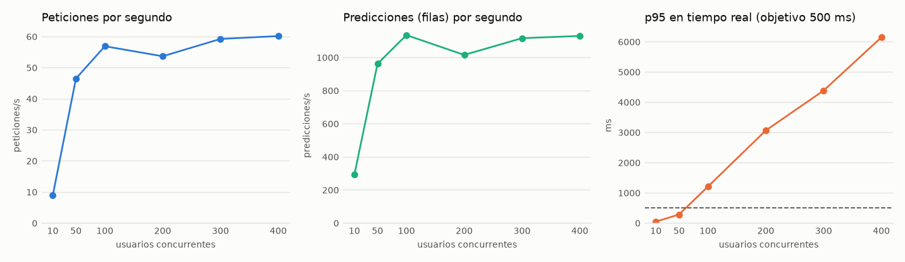
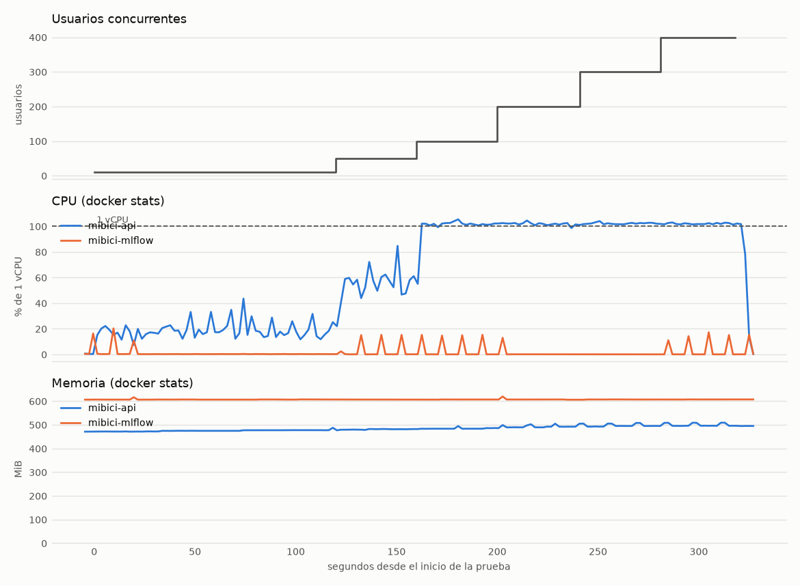

# Prueba de carga de la API (Locust)

Generado por `make carga` (`python -m carga.ejecutar`). No editar a mano.

- Fecha: 2026-11-23T05:38:43+00:00; API: `http://127.0.0.1:8000`
- Modelos: P1 mibici-equipo18-p1-demanda v1, P2 mibici-equipo18-p2-riesgo v1, P3 mibici-equipo18-p3-grupos v1
- Contenedor de la API: 1 vCPU, 1024 MiB, 1 worker(s) de uvicorn; filas por peticion: {'p2': 20, 'p1': 1000, 'p3': 470}
- Duracion: 320 s; peticiones: 11,970 (246,040 predicciones); errores: 0 (0.00 %)
- Latencia en tiempo real: p50 2605.3 ms, p95 5876.4 ms, p99 6123.2 ms
- Objetivo de servicio: p95 <= 500 ms y errores <= 1 %
- **Capacidad** (escalon con mas predicciones por segundo que cumple el objetivo): **961 predicciones/s** (46.5 peticiones/s) con 50 usuarios (p95 281 ms)

## Por escalon de usuarios

p50, p95 y p99: peticiones en tiempo real (P2 y /salud); los lotes van aparte.

| Usuarios | RPS | Predicciones/s | p50 (ms) | p95 (ms) | p99 (ms) | p95 lotes (ms) | Tasa de error | CPU API (%) | Memoria API max (MiB) | Cumple |
|---|---|---|---|---|---|---|---|---|---|---|
| 10 | 9.0 | 292.0 | 23.1 | 46.9 | 64.0 | 219.7 | 0 | 19.1 | 487.5 | si |
| 50 | 46.5 | 961.4 | 22.8 | 281.2 | 460.2 | 231.0 | 0 | 57.6 | 482.4 | si |
| 100 | 56.9 | 1,134.7 | 792.6 | 1,206.7 | 1,474.2 | 1,801.2 | 0 | 101.9 | 494.7 | no |
| 200 | 53.6 | 1,015.0 | 2,699.8 | 3,061.6 | 3,286.6 | 3,375.8 | 0 | 101.8 | 504.9 | no |
| 300 | 59.2 | 1,116.1 | 4,062.1 | 4,382.2 | 4,455.5 | 4,552.7 | 0 | 102.3 | 507.9 | no |
| 400 | 60.1 | 1,129.6 | 5,718.3 | 6,144.2 | 6,690.8 | 6,652.3 | 0 | 102.0 | 508.9 | no |

## Por endpoint (toda la prueba)

| Endpoint | Peticiones | Filas por peticion | RPS | p50 (ms) | p95 (ms) | p99 (ms) | Tasa de error |
|---|---|---|---|---|---|---|---|
| /predicciones/p1 [lote] | 27 | 1,000.0 | 0.08 | 65.3 | 5,931.1 | 6,608.3 | 0 |
| /predicciones/p2 | 10,717 | 20.0 | 33.5 | 2,667.1 | 5,901.4 | 6,137.9 | 0 |
| /predicciones/p3 [lote] | 10 | 470.0 | 0.03 | 1,547.0 | 3,143.5 | 3,163.2 | 0 |
| /salud | 1,216 | 0 | 3.8 | 1,930.5 | 5,366.1 | 5,675.9 | 0 |

## Recursos (docker stats)

| Contenedor | CPU promedio (%) | CPU max (%) | Memoria max (MiB) | Limite (MiB) |
|---|---|---|---|---|
| mibici-api | 63.4 | 105.4 | 508.9 | 1,024.0 |
| mibici-mlflow | 1.6 | 20.3 | 619.6 | 1,024.0 |

## Graficas

