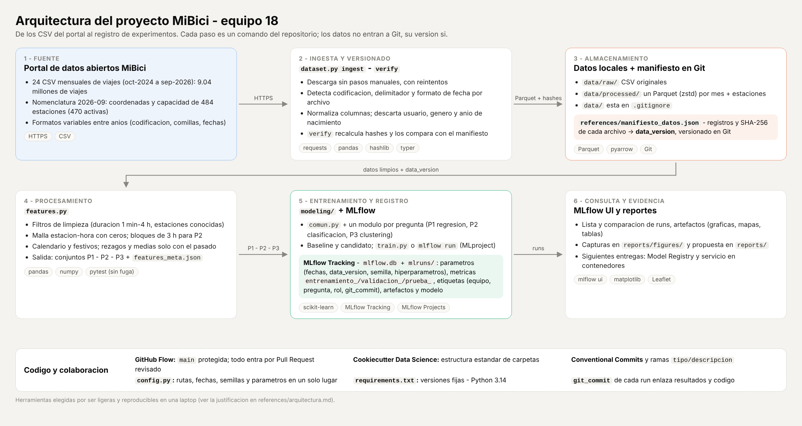

# Propuesta de solucion - Entrega 1 del proyecto integrador

**Equipo 18 - TC5061 Operaciones de aprendizaje automatico - Tecnologico de Monterrey**

MiBici es el sistema de bicicleta publica del Area Metropolitana de Guadalajara. Esta
propuesta describe como el equipo responde con Machine Learning las tres preguntas del
proyecto, que datos usa, el pipeline y la arquitectura, y el experimento base registrado en
MLflow que sirve como linea de referencia para el resto del curso.

> **Pendientes antes de entregar** (buscar `PENDIENTE` en este archivo): la tabla de metricas
> del experimento base con los datos reales, la lectura de resultados y las capturas de MLflow.

**Contenido**

1. [Formulacion del problema](#1-formulacion-del-problema)
2. [Datos](#2-datos)
3. [Pipeline de ML](#3-pipeline-de-ml)
4. [Modelos y metricas](#4-modelos-y-metricas)
5. [Arquitectura del sistema](#5-arquitectura-del-sistema)
6. [Experimento base en MLflow](#6-experimento-base-en-mlflow)
7. [Evidencia](#7-evidencia)
8. [Limitaciones y siguientes pasos](#8-limitaciones-y-siguientes-pasos)

---

## 1. Formulacion del problema

El ML Canvas completo esta en [`references/ml_canvas.md`](../references/ml_canvas.md)
(version visual en [`references/ml_canvas.png`](../references/ml_canvas.png)).

| | **P1 - Demanda (regresion)** | **P2 - Riesgo de desabasto (clasificacion)** | **P3 - Grupos de estaciones (clustering)** |
|---|---|---|---|
| **Que se predice o agrupa** | Numero de viajes que **inician** en cada estacion | Si la estacion tendra **riesgo de vaciarse** (faltan bicicletas), **riesgo de llenarse** (faltan anclajes) o **sin riesgo** | Grupos de estaciones con **perfiles de uso** parecidos y su ubicacion |
| **Granularidad** | Estacion x hora | Estacion x bloque de 3 h (00-03, 03-06, ..., 21-24) | Estacion (perfil calculado sobre un periodo) |
| **Horizonte** | 24 h: al cierre de cada dia se predicen las 24 horas del dia siguiente | El bloque que inicia: la alerta sale al comenzar cada turno de 3 h | Descriptivo; se recalcula cada trimestre y se mide su estabilidad |
| **Por que importa** | La demanda varia mucho por hora y por estacion; anticiparla permite tener bicicletas donde habra viajes y programar mantenimiento en horas valle | Una estacion vacia pierde viajes y una llena impide devolver la bicicleta; son las quejas operativas mas comunes de un sistema de bicicleta publica | Entender que estaciones son de origen (residenciales), de destino (laborales) o recreativas orienta la expansion y la definicion de zonas de rebalanceo |
| **Quien lo usa** | Operador del sistema (planeacion de flota) | Equipo de rebalanceo | Planeacion urbana y expansion (AMIM) |
| **Decision que toma** | Cuantas bicicletas poner en servicio y en que estaciones dejarlas al iniciar el dia | A que estaciones mandar camion primero y si hay que **llevar** o **retirar** bicicletas | Donde abrir estaciones, donde ampliar capacidad y como zonificar el rebalanceo |

**Como se relacionan las tres preguntas.** Las tres salen de la misma tabla base (viajes
contados por estacion y hora). P1 estima la demanda de salidas; P2 combina salidas,
llegadas y capacidad para anticipar desequilibrios; P3 resume el comportamiento de cada
estacion en un perfil y lo ubica en el mapa. Los grupos de P3 tambien pueden servir como
"zonas" para agregar P1 en entregas posteriores.

---

## 2. Datos

### 2.1 Rango de fechas: octubre 2024 a septiembre 2026 (24 meses)

| Criterio | Justificacion |
|---|---|
| **Representatividad** | Son los meses mas recientes: reflejan la red de estaciones y los habitos actuales, y coinciden con la nomenclatura vigente (`nomenclatura_2026_09.csv`), que es la unica que trae capacidad |
| **Estacionalidad** | Dos ciclos anuales completos: el entrenamiento ya contiene vacaciones, lluvias, fin de anio y Semana Santa, y la prueba (jul-sep 2026) tiene su equivalente del anio anterior en el entrenamiento |
| **Calidad** | Evita la caida atipica de 2020-2021 (pandemia) y los dos meses que el portal no publica (abril y mayo de 2023) |
| **Volumen** | Entre 315 mil y 490 mil viajes por mes, 9.04 millones en total: suficiente para los tres modelos y procesable en una laptop |
| **Particion** | Permite 18 meses de entrenamiento, 3 de validacion y 3 de prueba sin huecos |

El rango esta en `config.MES_INICIO` y `config.MES_FIN`; cambiarlo es cambiar dos lineas y
volver a correr la ingesta con `--actualizar-manifiesto`.

**Riesgo identificado:** en junio de 2026 Guadalajara fue sede de partidos de la Copa
Mundial de futbol; la validacion (abr-jun 2026) puede tener demanda atipica en esos dias.

### 2.2 Fuente

- Portal: <https://mibici.net/es/datos-abiertos/> (consultado el 14 de octubre de 2026).
- Nomenclatura de estaciones: <https://mibici.net/site/assets/files/1118/nomenclatura_2026_09.csv>
- Viajes por mes (el identificador de cada archivo no se deduce del mes; el catalogo
  completo 2014-2026 esta en `config.RUTAS_VIAJES` y la URL de cada mes usado queda en
  `references/manifiesto_datos.json`):

| Mes | Archivo | Mes | Archivo |
|---|---|---|---|
| 2024-10 | [datos_abiertos_2024_10.csv](https://mibici.net/site/assets/files/91758/datos_abiertos_2024_10.csv) | 2025-10 | [datos_abiertos_2025_10.csv](https://mibici.net/site/assets/files/115104/datos_abiertos_2025_10.csv) |
| 2024-11 | [datos_abiertos_2024_11.csv](https://mibici.net/site/assets/files/93516/datos_abiertos_2024_11.csv) | 2025-11 | [datos_abiertos_2025_11.csv](https://mibici.net/site/assets/files/116773/datos_abiertos_2025_11.csv) |
| 2024-12 | [datos_abiertos_2024_12.csv](https://mibici.net/site/assets/files/94962/datos_abiertos_2024_12.csv) | 2025-12 | [datos_abiertos_2025_12.csv](https://mibici.net/site/assets/files/118153/datos_abiertos_2025_12.csv) |
| 2025-01 | [datos_abiertos_2025_01.csv](https://mibici.net/site/assets/files/97653/datos_abiertos_2025_01.csv) | 2026-01 | [datos_abiertos_2026_01.csv](https://mibici.net/site/assets/files/120163/datos_abiertos_2026_01.csv) |
| 2025-02 | [datos_abiertos_2025_02.csv](https://mibici.net/site/assets/files/99879/datos_abiertos_2025_02.csv) | 2026-02 | [datos_abiertos_2026_02.csv](https://mibici.net/site/assets/files/121761/datos_abiertos_2026_02.csv) |
| 2025-03 | [datos_abiertos_2025_03.csv](https://mibici.net/site/assets/files/101986/datos_abiertos_2025_03.csv) | 2026-03 | [datos_abiertos_2026_03.csv](https://mibici.net/site/assets/files/123236/datos_abiertos_2026_03.csv) |
| 2025-04 | [datos_abiertos_2025_04.csv](https://mibici.net/site/assets/files/103813/datos_abiertos_2025_04.csv) | 2026-04 | [datos_abiertos_2026_04.csv](https://mibici.net/site/assets/files/124927/datos_abiertos_2026_04.csv) |
| 2025-05 | [datos_abiertos_2025_05.csv](https://mibici.net/site/assets/files/105513/datos_abiertos_2025_05.csv) | 2026-05 | [datos_abiertos_2026_05.csv](https://mibici.net/site/assets/files/125943/datos_abiertos_2026_05.csv) |
| 2025-06 | [datos_abiertos_2025_06.csv](https://mibici.net/site/assets/files/107088/datos_abiertos_2025_06.csv) | 2026-06 | [datos_abiertos_2026_06.csv](https://mibici.net/site/assets/files/127734/datos_abiertos_2026_06.csv) |
| 2025-07 | [datos_abiertos_2025_07.csv](https://mibici.net/site/assets/files/108898/datos_abiertos_2025_07.csv) | 2026-07 | [datos_abiertos_2026_07.csv](https://mibici.net/site/assets/files/129006/datos_abiertos_2026_07.csv) |
| 2025-08 | [datos_abiertos_2025_08.csv](https://mibici.net/site/assets/files/111021/datos_abiertos_2025_08.csv) | 2026-08 | [datos_abiertos_2026_08.csv](https://mibici.net/site/assets/files/130362/datos_abiertos_2026_08.csv) |
| 2025-09 | [datos_abiertos_2025_09.csv](https://mibici.net/site/assets/files/113216/datos_abiertos_2025_09.csv) | 2026-09 | [datos_abiertos_2026_09.csv](https://mibici.net/site/assets/files/131825/datos_abiertos_2026_09.csv) |

### 2.3 Tamanio real obtenido

Generado por la ingesta a partir del manifiesto versionado (`references/manifiesto_datos.json`,
`data_version` **06b0010a4627**); el detalle por mes esta en
[`reports/resumen_datos.md`](resumen_datos.md).

| Concepto | Valor |
|---|---|
| Meses | 24 (oct-2024 a sep-2026), sin meses faltantes |
| Viajes (filas crudas) | 9,043,925 |
| Viajes despues de la normalizacion | 9,043,167 (758 `Viaje_Id` repetidos, todos en 2026-09) |
| Viajes por mes | de 315,895 (2026-05) a 489,298 (2026-09) |
| Estaciones en la nomenclatura | 484 (470 activas; 14 retiradas o sin capacidad) |
| Estaciones con al menos un viaje en el rango | 472 |
| Version de datos (`data_version`) | `06b0010a4627` |
| Viajes validos tras los filtros de limpieza | PENDIENTE: `filtros` en `data/processed/features_meta.json` |

**Observacion de los datos reales:** las estaciones con viajes por mes pasan de 360-371
(oct-2024 a may-2026) a 427, 453, 467 y 468 de junio a septiembre de 2026. Casi 100 estaciones
nuevas aparecen en validacion y prueba. Consecuencias: en P1 y P2 una estacion nueva entra al
modelo cuando ya tiene la historia que piden los rezagos (14 dias en P1, 7 en P2); en P3 la
estabilidad se mide solo con las estaciones presentes en ambos periodos y las nuevas se asignan
al grupo mas cercano.

### 2.4 Variables originales y construccion de los objetivos

**Viajes** (`datos_abiertos_AAAA_MM.csv`; los nombres y la codificacion varian entre anios,
la ingesta los lleva a un esquema unico):

| Columna original | Columna normalizada | Uso |
|---|---|---|
| `Viaje_Id` | `viaje_id` | Detectar duplicados |
| `Usuario_Id` | - | **Se descarta en la lectura** (dato personal; no se necesita) |
| `Genero` | - | **Se descarta en la lectura** (dato personal) |
| Anio de nacimiento (en el CSV se escribe con enie y a veces llega mal codificado) | - | **Se descarta en la lectura** (dato personal) |
| `Inicio_del_viaje` | `inicio_viaje` | Hora de la salida (P1, P2, P3) |
| `Fin_del_viaje` | `fin_viaje` | Hora de la llegada (P2, P3) y duracion |
| `Origen_Id` | `origen_id` | Estacion de salida |
| `Destino_Id` | `destino_id` | Estacion de llegada |

**Estaciones** (`nomenclatura_2026_09.csv`): `id` -> `estacion_id`, `name` -> `nombre`
(de el se extraen el codigo, p. ej. `GDL-001`, y el municipio), `latitude`/`longitude` ->
`latitud`/`longitud`, `dpcapacity` -> `capacidad`. Las estaciones con prefijo "ex-" o
capacidad 0 se marcan como retiradas.

**Variaciones de formato encontradas en el portal** (todas manejadas por `dataset.py` y
cubiertas por pruebas): 7 meses vienen en Windows-1252 (2024-10 a 2025-02, 2025-07 y 2026-01)
y 17 en UTF-8; la enie del encabezado del anio de nacimiento aparece rota en varios meses;
octubre de 2024 usa fechas `01/10/2024 0:00` (dia/mes, sin segundos) y el resto
`2025-06-01 00:00:08`; valores nulos escritos como `NULL`. Como octubre de 2024 no trae
segundos, en ese mes la duracion tiene resolucion de minutos.

**Construccion de los objetivos** (despues de filtrar viajes de menos de 1 minuto o mas
de 4 horas y con estaciones fuera de la nomenclatura):

- **P1:** `salidas(estacion, hora)` = numero de viajes con `origen_id` = estacion cuyo
  `inicio_viaje` cae en esa hora. Las horas sin viajes cuentan como 0 (se completa la
  malla horaria de cada estacion).
- **P2:** el portal no publica el inventario de bicicletas, asi que el riesgo se aproxima
  con el **flujo neto** del bloque, `neto = salidas - llegadas`, y la **capacidad**:
  - `riesgo_vaciado` (1) si `neto >= 0.5 x capacidad`,
  - `riesgo_llenado` (2) si `-neto >= 0.5 x capacidad`,
  - `sin_riesgo` (0) en otro caso.

  **Justificacion:** despues del rebalanceo nocturno una estacion suele empezar el turno
  cerca de la mitad de su capacidad; perder (o ganar) la mitad de su capacidad en tres
  horas la deja vacia (o llena). El umbral (0.5) y el tamanio del bloque (3 h) estan en
  `config.py` y se registran en cada run. **Limitacion:** la demanda observada esta
  censurada (en una estacion vacia nadie puede sacar bicicleta), por lo que la etiqueta
  tiende a subestimar el riesgo real.
- **P3:** no hay objetivo. Cada estacion se describe con su perfil: fraccion de salidas y
  llegadas en cada hora (dias laborales y fines de semana por separado), viajes diarios,
  relacion fin de semana/laboral y balance neto.

### 2.5 Condiciones de uso y tratamiento de datos personales

**Lo que publica MiBici** (revisado el 14 de octubre de 2026):

- El portal ofrece los archivos como "datos abiertos", pero **no indica una licencia
  explicita** ni condiciones de atribucion.
- Los [terminos y condiciones](https://mibici.net/es/termino-y-condiciones/) regulan el
  uso del servicio de bicicletas, no el de los datos; el pie de pagina indica "Todos los
  derechos reservados".
- El [aviso de privacidad](https://mibici.net/es/aviso-de-privacidad/) tiene como
  responsable a la Agencia Metropolitana de Servicios de Infraestructura para la Movilidad
  (AMIM) y cita la Ley General de Proteccion de Datos Personales en Posesion de Sujetos
  Obligados y la ley equivalente del Estado de Jalisco; no menciona los datos abiertos ni
  su anonimizacion.

**Tratamiento que da el equipo:**

1. **Uso academico y no comercial**, citando la fuente (portal de datos abiertos de MiBici).
2. **No redistribucion:** los CSV no se suben al repositorio (`data/` esta en
   `.gitignore`); cada integrante los descarga del portal oficial con la ingesta.
3. **Minimizacion:** `Usuario_Id`, `Genero` y el anio de nacimiento son datos personales
   seudonimizados que el proyecto no necesita; **no se leen** del CSV, asi que no llegan a
   los Parquet, a las variables, a MLflow, a las graficas ni a los modelos.
4. **Agregacion:** los modelos y resultados trabajan con conteos por estacion y hora; no se
   reporta informacion a nivel de viaje individual ni se intenta reidentificar a nadie.
5. **Sin credenciales en el codigo:** cualquier credencial futura va solo en `.env`.

### 2.6 Estrategia de particion y como se evita usar informacion del futuro

| Conjunto | Periodo | Uso |
|---|---|---|
| Entrenamiento | 1-oct-2024 a 31-mar-2026 (18 meses) | Ajustar modelos, escaladores, PCA y grupos |
| Validacion | 1-abr-2026 a 30-jun-2026 (3 meses) | Comparar baseline y candidato y elegir alternativas |
| Prueba | 1-jul-2026 a 30-sep-2026 (3 meses) | Estimacion final; se reporta una sola vez por modelo elegido |

Medidas contra la fuga de informacion:

1. **Particion cronologica**, nunca aleatoria (`features.asignar_particion`), con las
   fechas de corte en `config.py`.
2. **Variables solo del pasado:** en P1 todos los rezagos y medias usan datos con al menos
   24 h de antiguedad (el horizonte) y el codigo falla si un rezago es menor; en P2 solo se
   usan bloques ya cerrados. Las llegadas o el flujo del mismo periodo que se predice **no**
   son variables. Los baselines usan las mismas variables (P1 el rezago de 7 dias, P2 las
   frecuencias de los 7 dias previos), asi que tampoco ven el futuro.
3. **Pruebas automaticas** (`tests/test_features.py`): se alteran todos los datos a partir
   de una fecha y se verifica que las variables de las filas anteriores al horizonte no
   cambian (y que si cambian despues, para que la prueba no sea trivial).
4. **Ajustes solo con entrenamiento:** el escalador, la PCA, los cortes de cuartiles y
   K-means de P3 se ajustan con los perfiles del periodo de entrenamiento; los de
   validacion y prueba se calculan por separado y solo se asignan. El numero de grupos se
   elige con la silhouette de entrenamiento.
5. **Catalogo de estaciones:** el portal solo publica la nomenclatura vigente (sep-2026),
   asi que la capacidad y la ubicacion se toman de ese corte para todo el periodo. Para que
   la capacidad no delate que estaciones se retiraran, en las tres preguntas se modelan solo
   las estaciones vigentes (sin prefijo "ex-" y con capacidad > 0).

### 2.7 Versionado y reproducibilidad de los datos

`python -m tc5061_proyecto_equipo18.dataset ingest` descarga, normaliza y guarda un Parquet por
mes; el manifiesto guarda, por archivo, las filas y el SHA-256 del CSV crudo y del contenido
limpio, y la `data_version` es el hash de esos hashes. `dataset verify` comprueba que los datos
locales coinciden con el manifiesto.

La comprobacion entre computadoras encontro un caso real: con el mismo CSV de estaciones, macOS
y Windows daban hashes distintos porque las coordenadas traen 17 cifras significativas y el
lector rapido de pandas no siempre redondea igual en cada procesador. Se corrigio leyendo las
coordenadas con `float()` de Python, que siempre redondea al valor mas cercano (PR #6), y la
version **06b0010a4627** se reconstruyo identica en macOS y en Windows (PR #4).

---

## 3. Pipeline de ML

```text
CSV del portal --> dataset.py ingest --> Parquet limpio + manifiesto (data_version)
                                              |
                                              v
                      features.py: filtros de limpieza --> malla estacion x hora (con ceros)
                                              |
              +-------------------------------+-------------------------------+
              v                               v                               v
   P1: rezagos >= 24 h + calendario   P2: bloques de 3 h + etiqueta   P3: perfiles por periodo
              |                          + rezagos de bloques cerrados          |
              v                               v                               v
 rezago semanal | HGB Poisson    frecuencia 7 dias | HGB balanceado   cuartiles | K-means + PCA
              +---------> evaluacion validacion / prueba --> MLflow (un run por modelo) <----+
```

### Etapas comunes

| Etapa | Que se hace | Donde |
|---|---|---|
| Ingesta | Descarga, normalizacion de columnas, codificacion y fechas; eliminacion de nulos y duplicados; Parquet por mes; manifiesto | `dataset.py` |
| Limpieza | Quita viajes < 1 min (desanclajes fallidos), > 4 h (bicicleta mal anclada) y con estaciones fuera de la nomenclatura; reporta cuantos quito por causa | `features.filtrar_viajes_validos` |
| Agregacion | Salidas por estacion y hora de inicio, llegadas por estacion y hora de fin; malla completa con ceros | `features.contar_por_estacion_hora` |
| Calendario | Hora, dia de la semana, fin de semana, festivo (LFT art. 74 + jueves y viernes santos), mes | `features.agregar_calendario` |

### Variables por pregunta y por que son pertinentes

**P1 (estacion x hora, horizonte 24 h)** - `features.COLUMNAS_P1`

| Variable | Pertinencia |
|---|---|
| `salidas_lag_24h`, `_48h`, `_168h`, `_336h` | Misma hora hace 1, 2, 7 y 14 dias: la demanda se repite por dia y por semana |
| `salidas_media_misma_hora_7d` | Nivel tipico reciente de esa hora en esa estacion, menos ruidoso que un solo rezago |
| `salidas_media_24h_previa`, `salidas_media_7d` | Nivel general reciente de la estacion (tendencia corta, cierres temporales) |
| `llegadas_lag_24h` | Bicicletas que ayer llegaron a esa hora: anticipa disponibilidad y patrones de ida y vuelta |
| `hora_dia`, `dia_semana`, `es_fin_semana`, `es_festivo`, `mes` | Ciclos diario, semanal y anual; se conocen de antemano |
| `capacidad`, `latitud`, `longitud` | Tamanio y entorno urbano de la estacion |

**P2 (estacion x bloque de 3 h, al inicio del bloque)** - `features.COLUMNAS_P2`

| Variable | Pertinencia |
|---|---|
| `salidas_lag_1b`, `llegadas_lag_1b`, `neto_lag_1b` | Lo que acaba de pasar en el bloque anterior (inercia del desequilibrio) |
| `neto_lag_dia`, `neto_lag_semana` | Mismo bloque ayer y hace una semana: patrones diarios y semanales |
| `neto_media_mismo_bloque_7d`, `neto_rel_media_mismo_bloque_7d`, `neto_rel_lag_dia` | Desequilibrio tipico del bloque, tambien relativo a la capacidad (la etiqueta depende de esa proporcion) |
| `frac_vaciado_mismo_bloque_7d`, `frac_llenado_mismo_bloque_7d` | Que tan seguido ese bloque estuvo en riesgo la ultima semana (tambien es el baseline) |
| `salidas_previas_24h` | Actividad reciente de la estacion |
| `bloque_dia`, calendario, `capacidad`, `latitud`, `longitud` | Igual que en P1 |

**P3 (estacion, por periodo)**

| Variable | Pertinencia |
|---|---|
| `sal_lab_h00...h23`, `lle_lab_h00...h23` | Forma del dia laboral: separa estaciones de origen matutino (residenciales) de destino matutino (laborales) |
| `sal_fds_h00...h23`, `lle_fds_h00...h23` | Uso en fines de semana y festivos (recreativo) |
| `log_viajes_dia` | Volumen (escala log para que pocas estaciones muy grandes no dominen) |
| `ratio_fin_semana`, `balance_neto` | Dependencia del fin de semana y tendencia a llenarse o vaciarse |

La ubicacion (latitud, longitud) **no** entra al clustering: los grupos se forman por uso y
despues se ubican en el mapa, que es justo lo que pregunta P3.

### Entrenamiento y evaluacion

- **P1:** el candidato se entrena con una muestra reproducible de hasta 3 millones de filas del
  entrenamiento (`config.P1_MAX_FILAS_ENTRENAMIENTO`, con la semilla del proyecto) para acotar
  la memoria; baseline y candidato se evaluan con las mismas filas de validacion y prueba.
- **P2:** el candidato se entrena con todo el entrenamiento y pesos de clase balanceados;
  predice la clase de mayor probabilidad. Baseline y candidato se evaluan con las mismas filas.
- **P3:** escalado, PCA (90 % de la varianza) y K-means se ajustan con los perfiles de
  entrenamiento; k se elige entre 3 y 8 por silhouette de entrenamiento. Se mide la calidad en
  cada periodo y la estabilidad en validacion y prueba.
- Todo es determinista con `config.SEMILLA`: repetir un run con los mismos datos y el mismo
  commit da exactamente las mismas metricas.

---

## 4. Modelos y metricas

Las metricas siguen la guia de evaluacion de scikit-learn
(<https://scikit-learn.org/stable/modules/model_evaluation.html>) y se registran con el
prefijo del conjunto en que se calculan (`entrenamiento_`, `validacion_`, `prueba_`).

| | Baseline | Candidato | Metricas | Metrica principal |
|---|---|---|---|---|
| **P1** | **Rezago semanal** (`rezago_semanal`): las salidas de la misma estacion y hora hace 7 dias | **HistGradientBoostingRegressor** con perdida Poisson (`hgb_poisson`), adecuada para conteos | `mae`, `rmse`, `wape`, `devianza_poisson`, `r2` | `validacion_mae` para elegir; `prueba_mae` y `prueba_wape` para reportar |
| **P2** | **Frecuencia del mismo bloque** (`frecuencia_mismo_bloque`): la clase mas frecuente de ese bloque en los ultimos 7 dias | **HistGradientBoostingClassifier** con pesos de clase balanceados (`hgb_balanceado`) | `f1_macro`, `balanced_accuracy`, y por clase de riesgo `recall_*`, `precision_*`, `pr_auc_*` | `validacion_f1_macro` para elegir; `prueba_f1_macro` y `prueba_recall_vaciado` / `prueba_recall_llenado` para reportar |
| **P3** | **Cuartiles de volumen** (`cuartiles_volumen`): 4 grupos por viajes diarios, con cortes de entrenamiento | **K-means sobre PCA** de los perfiles (`kmeans_pca`), k entre 3 y 8 por silhouette | `silhouette`, `davies_bouldin`, `calinski_harabasz`, `estabilidad_ari` | `entrenamiento_silhouette` para elegir k; `prueba_estabilidad_ari` para reportar |

**Por que estas metricas son coherentes con la decision**

- **P1.** El operador razona en "bicicletas por hora": el **MAE** se lee en esas unidades y
  no lo dominan unas pocas horas extremas. El **RMSE** castiga mas los errores grandes, que
  son los que dejan una estacion sin bicicletas en hora pico. El **WAPE** (error absoluto
  total entre demanda total) permite comparar periodos de distinto volumen y, a diferencia
  del MAPE, no se indefine en las muchas horas con cero viajes. La **devianza Poisson** es la
  perdida que optimiza el candidato y mide el ajuste propio de conteos. El **R2** da una
  lectura relativa a predecir el promedio.
- **P2.** Las clases de riesgo son minoritarias, asi que la exactitud enganaria: predecir
  siempre "sin riesgo" tendria exactitud alta sin detectar ningun riesgo. El **F1 macro** y
  la **exactitud balanceada** pesan igual las tres clases. El **recall** de cada clase de
  riesgo mide los desabastos que se anticipan (un riesgo no detectado es una estacion vacia o
  llena) y la **precision** mide cuantas alertas valen un viaje de camion. La **PR-AUC**
  (precision promedio) resume la curva precision-recall sin depender de la regla de decision
  y se compara contra la prevalencia de la clase.
- **P3.** No hay etiqueta, asi que se mide la calidad interna: **silhouette** (-1 a 1, mayor
  es mejor), **Davies-Bouldin** (menor es mejor) y **Calinski-Harabasz** (mayor es mejor).
  Para planear, un grupo debe ser estable: el **ARI** compara el grupo de cada estacion en
  entrenamiento con el que obtiene al medir su perfil en meses posteriores (1 = identico,
  0 = azar).

**Candidatos para iteraciones siguientes:** LightGBM o XGBoost con clima (lluvia) y eventos
masivos para P1; umbrales por clase elegidos en validacion segun el costo de cada error y
calibracion de probabilidades para P2; clustering jerarquico, mezcla gaussiana o HDBSCAN para P3.

---

## 5. Arquitectura del sistema



El detalle de componentes, herramientas y su justificacion con las lecturas de la semana
(Huyen, 2022; Wilson, 2022; Lauchande, 2021; Thompson, 2023) esta en
[`references/arquitectura.md`](../references/arquitectura.md). En resumen:

| Componente | Herramienta |
|---|---|
| Fuente | Portal de datos abiertos de MiBici (HTTPS) |
| Ingesta | `dataset.py` (requests, pandas, typer) |
| Almacenamiento | `data/raw` (CSV) y `data/processed` (Parquet) locales; manifiesto JSON en Git |
| Procesamiento | `features.py` (pandas, numpy) |
| Entrenamiento | `modeling/`: `comun.py` (registro comun) + `p1_regresion.py`, `p2_clasificacion.py`, `p3_clustering.py`, orquestados por `train.py` (scikit-learn) |
| Registro de experimentos | MLflow Tracking (SQLite `mlflow.db` + `mlruns/`) y MLflow Projects (`MLproject`) |
| Colaboracion | GitHub con GitHub Flow, Cookiecutter Data Science |

**Refactorizacion.** Lo que es igual para todas las preguntas (abrir el run con sus etiquetas,
parametros comunes, metricas con prefijo, figuras y modelo) vive una sola vez en `comun.py`.
Cada pregunta es un modulo que cumple el mismo contrato, `entrenar(roles) -> run_ids`, y
`train.py` solo los descubre y los invoca. Asi cada integrante trabajo su pregunta en un PR
aparte sin duplicar el registro.

---

## 6. Experimento base en MLflow

- **Experimento:** `mibici-equipo18`.
- **Runs** (uno por modelo; nombres descriptivos, nunca los aleatorios por defecto):

| Run | Pregunta | Modelo | Metricas principales (prueba) |
|---|---|---|---|
| `p1-baseline-rezago_semanal` | P1 | Rezago semanal | PENDIENTE `prueba_mae`, `prueba_wape` |
| `p1-candidato-hgb_poisson` | P1 | HistGradientBoosting (Poisson) | PENDIENTE |
| `p2-baseline-frecuencia_mismo_bloque` | P2 | Clase mas frecuente del bloque en 7 dias | PENDIENTE `prueba_f1_macro`, `prueba_recall_vaciado`, `prueba_recall_llenado` |
| `p2-candidato-hgb_balanceado` | P2 | HistGradientBoosting (balanceado) | PENDIENTE |
| `p3-baseline-cuartiles_volumen` | P3 | Cuartiles de volumen | PENDIENTE `entrenamiento_silhouette`, `prueba_estabilidad_ari` |
| `p3-candidato-kmeans_pca` | P3 | K-means sobre PCA (k por silhouette) | PENDIENTE |

- **Parametros en cada run:** semilla; parametros de features (`features.mes_inicio`,
  `features.mes_fin`, cortes de entrenamiento y validacion, filtros de duracion, horizonte,
  rezagos, tamanio de bloque, umbral de riesgo y minimo de viajes de P3); `data_version`;
  `modelo` y todos sus hiperparametros.
- **Etiquetas:** `equipo`, `pregunta`, `rol` (baseline o candidato), `modelo`, `data_version`,
  `git_commit` y `git_sucio` (debe ser `false` en los runs que se reportan).
- **Artefactos:** en todos, `datos/features_meta.json` y el manifiesto de datos. P1: real vs.
  predicho, error por hora e importancia de variables. P2: matriz de confusion, curvas
  precision-recall, riesgo por bloque e importancia de variables. P3: mapa de grupos, perfiles
  horarios por grupo, silhouette por k, mapa interactivo (HTML) y tablas de resumen y
  asignaciones. Los candidatos registran ademas el modelo (formato skops, con firma).

Los runs se ejecutan desde el codigo del repositorio:

```powershell
python -m tc5061_proyecto_equipo18.modeling.train --todos          # los 6 runs (o: make train)
python -m tc5061_proyecto_equipo18.modeling.train --pregunta P2 --modelo candidato
# un run como MLflow Project:
mlflow run . -P pregunta=P1 -P tipo_modelo=candidato --env-manager local --experiment-name mibici-equipo18
mlflow ui --backend-store-uri sqlite:///mlflow.db                  # o: make mlflow-ui
```

**Lectura de resultados:** PENDIENTE (2-3 lineas por pregunta: el candidato supera al
baseline en validacion? que horas, estaciones o clases fallan mas? que grupos aparecen
y donde se ubican?).

---

## 7. Evidencia

Capturas de la interfaz de MLflow, guardadas en `reports/figures/mlflow/`:

| Evidencia | Archivo |
|---|---|
| Lista de runs del experimento | `reports/figures/mlflow/01_lista_runs.png` |
| Detalle de un run: parametros, metricas y etiquetas | `reports/figures/mlflow/02_detalle_run.png` |
| Artefacto registrado (p. ej. mapa de grupos de P3) | `reports/figures/mlflow/03_artefacto.png` |
| Comparacion de dos o mas runs | `reports/figures/mlflow/04_comparacion_runs.png` |

PENDIENTE: insertar aqui las cuatro imagenes una vez tomadas, por ejemplo
``.

---

## 8. Limitaciones y siguientes pasos

- **Catalogo de estaciones de un solo corte:** sin historico de capacidad ni de altas y
  bajas; los viajes de estaciones que ya no aparecen en la nomenclatura se descartan.
- **Estaciones nuevas en validacion y prueba:** casi 100 estaciones aparecen entre junio y
  septiembre de 2026; P1 y P2 las incluyen cuando ya tienen historia suficiente, y para
  estaciones sin historia se puede usar su grupo de P3 como referencia.
- **Etiqueta de P2 aproximada:** sin inventario real; si MiBici publica disponibilidad en
  tiempo real, se usara para validar la aproximacion y ajustar el umbral.
- **Regla de decision de P2:** el candidato elige la clase mas probable; elegir un umbral por
  clase segun el costo de una alerta falsa frente a un riesgo no detectado puede mejorar el
  recall de las clases de riesgo.
- **Eventos y clima:** faltan variables de lluvia y eventos masivos (p. ej. partidos del
  Mundial en junio de 2026).
- **Seguimiento compartido:** cada integrante tiene su propio `mlflow.db`; para las
  siguientes entregas conviene un servidor compartido configurado en `.env`.
- **Siguientes entregas:** registrar los candidatos en el Model Registry, monitoreo de
  deriva y servicio en contenedores.

## Referencias

- Huyen, C. (2022). *Designing Machine Learning Systems*. O'Reilly Media. Cap. 6.
- Lauchande, N. (2021). *Machine Learning Engineering with MLflow*. Packt. Cap. 5.
- Thompson, S. (2023). *Managing Machine Learning Projects*. Manning. Sec. 7.4.
- Wilson, B. (2022). *Machine Learning Engineering in Action*. Manning. Cap. 6.
- Dorard, L. *Machine Learning Canvas*. <https://www.ownml.co/machine-learning-canvas>
- MLflow. *MLflow Tracking* y *MLflow Projects*. <https://mlflow.org/docs/latest/ml/>
- scikit-learn. *Metrics and scoring: quantifying the quality of predictions*.
  <https://scikit-learn.org/stable/modules/model_evaluation.html>
- MiBici. *Datos abiertos*. <https://mibici.net/es/datos-abiertos/>
